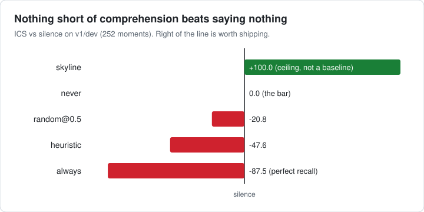

# TactBench

[](https://github.com/max-friedman/tactbench/actions/workflows/ci.yml)
[](LICENSE)
[](LICENSE-DATA)

**A benchmark for whether an assistant should speak at all.**

Nearly every LLM evaluation asks *how good is the answer*. Proactive assistants —
the notification that surfaces itself, the suggestion chip, the ambient agent —
face a prior question that no common benchmark scores: **should you have said
anything?**

That question is not accuracy. Its costs are asymmetric and state-dependent.
Interrupting someone mid-meeting is not the same mistake as interrupting them
while they wait for coffee, and neither is the same as waking them at 3am. A
system optimized for helpfulness will fail it in a specific, predictable way: it
will be helpful too often.

TactBench scores that judgment.



```bash
git clone https://github.com/max-friedman/tactbench && cd tactbench
uv run tactbench demo
```

## Results

Built-in policies on `v1/dev` (252 moments, 9 scenario families):

| policy | ICS ↓ | vs silence | vs pair-blind | prec@int ↑ | recall-hv ↑ | ECE ↓ | hard viol. ↓ | spoke |
|---|---|---|---|---|---|---|---|---|
| `skyline` *(ceiling, not a baseline)* | **0.0** | **+100.0** | **+100.0** | 1.000 | 1.000 | 0.075 | 0 | 126/252 |
| `never` *(the shipping bar)* | 336.0 | 0.0 | −41.2 | — | 0.000 | 0.500 | 0 | 0/252 |
| `random@0.5` | 406.0 | −20.8 | −70.6 | 0.507 | 0.540 | 0.008 | 9 | 134/252 |
| `heuristic` | 496.0 | −47.6 | −108.4 | 0.500 | 0.127 | 0.171 | 10 | 32/252 |
| `always` | 630.0 | −87.5 | −164.7 | 0.500 | 1.000 | 0.500 | 28 | 252/252 |

Read the `always` row carefully. It has **perfect recall** — it never misses a
single cue worth surfacing — and it is the worst policy on the board, costing 294
more ICS than saying nothing at all (−87.5 normalized). That gap is the argument
for this benchmark.
Optimize for helpfulness and you land on that row.

Then read the `heuristic` row. A hand-written rule set with no comprehension lands
at **0.500 precision — a coin flip** — and also loses to silence. That
is by design: every surface shortcut it used to exploit has been removed from the
dataset (see [Shortcut resistance](#shortcut-resistance) below). Pattern matching
gets no traction here.

`skyline` proves the bar is clearable. It reads the same text, never sees a label,
and resolves what each moment actually turns on — which gate you're standing at,
whether the page names you or your colleague. It scores perfectly, so the headroom
between silence and solved is real. It is **not** a baseline: it's a template
parser tuned to this generator, included only to mark the ceiling.

So `never` is the bar: a proactive feature that scores worse than silence is a
feature that should not ship. **But clearing it does not show comprehension, and
earlier versions of this README said it did.** Round 23 found that a policy which
speaks whenever one of five topic words appears — `return`, `autopay`,
`prescription`, `contract`, `gate` — and is silent otherwise scores **+29.2**
against silence, on dev and on the held-out split, with zero hard violations. It
never reads which side of a pair it is on. Each of those words marks a family where
a missed cue costs more than a false alarm, so speaking on *both* sides of every
pair there is net-positive.

**So there are two bars, and the table reports both.** *Silence* is the bar for
being worth shipping. The *pair-blind* bar is the best any policy can do without
reading the moment: per matched pair, the cheaper of "both sides silent" and "both
sides speak", never paying with a hard violation. The two sides of a pair share a
body and a user state, so a policy that does not read the decider cannot do better —
beating the pair-blind bar *requires* telling the sides apart. On `v1/dev` it sits
at ICS 238 against silence's 336, and silence itself scores −41.2 against it. The
costs were left as they are on purpose: speaking about a changed gate to an idle
traveller on both sides of the pair really is better for the user than silence.
What was wrong was the claim that beating silence shows comprehension.

### How good does a system have to be?

The leaderboard shows chance-precision policies losing to silence and a perfect
one winning. That leaves the question every real system actually faces: *how much
comprehension is enough?*

Sweeping a policy that resolves a controlled fraction `p` of moments correctly and
guesses on the rest:

| comprehension `p` | ICS ↓ | vs silence | prec@int |
|---|---|---|---|
| 0.0 | 482.0 | −43.5 | 0.508 |
| 0.2 | 363.0 | −8.0 | 0.605 |
| **0.4** | **206.0** | **+38.7** | 0.744 |
| 0.6 | 142.0 | +57.7 | 0.849 |
| 0.8 | 94.0 | +72.0 | 0.901 |
| 1.0 | 0.0 | +100.0 | 1.000 |

**In this draw a system needs about p = 0.23 comprehension to beat silence**, and
`p = 0.2` still loses while reaching 0.605 precision — which reads as "better than a
coin flip" and is a net loss. **Read that as one draw, not a constant.** Both
which moments a given `p` comprehends and the coin flip on the others are chosen by
hashing the moment's id; Round 26 changed only the id the policy sees (to stop it
leaking the label), which redrew both at once, and break-even moved from 0.29 to
0.23, with `p = 0.4` moving from +10.1 to +38.7.
The sweep rests on two random choices: *which* moments a given `p` understands, and
the coin flip on every moment it does not. Varying each over 20 draws, the smallest
`p` that beats silence (0.01 grid):

| varied | break-even range | median |
|---|---|---|
| which moments are understood | 0.22 – 0.43 | 0.325 |
| coin flips on the rest | 0.13 – 0.38 | 0.235 |
| both | 0.10 – 0.53 | 0.295 |

**So there is no single "comprehension needed" figure.** Each source alone moves it
two- to threefold, and neither dominates. With both varied, `p = 0.4` runs from
−14.0 to +38.7 against silence, and the sweep table earlier in this section is the
most favourable of the 20 draws at that row. What holds on every draw of every source is the metric's
own behaviour — monotone, anchored, and no step smaller than 2.5% of the range
(`experiments/sweep_draws.py`; asserted per draw), though that is close to the 2%
floor the test enforces.

The sweep also establishes that ICS is **monotone, anchored, and responsive across
the whole range** — it ranks partial comprehension rather than merely separating
none from perfect. That matters because the middle is where every real system
lands. Guarded by `TestMetricDiscrimination`; full sweep in
[`experiments/discrimination_sweep.py`](experiments/discrimination_sweep.py).

## Shortcut resistance

The claim that matched pairs prevent keyword matching is worth exactly its
evidence, so the benchmark measures it rather than asserting it:

```bash
uv run tactbench audit
```

This trains classifiers on **signal text alone** — no user state, no DND flag, no
slice tags — and reports how well they separate *speak* from *stay quiet*. Chance
is 50%.

**v1 failed this badly: the probe hit 93.5%.** Each scenario had one fixed phrasing
per side, so whole sentences differed and tokens like `hallway`, `inflight`, and
`closes` appeared on exactly one side. The pairing was real in structure and
useless in practice.

The fix was a construction principle: **make each pair as close to a token
permutation as the scenario allows.** Swap roles instead of rewriting sentences —
primary and secondary on-call trade places, the two boxes trade which one is still
sealed, the two meetings trade which is ahead and which has passed. Both sides then
carry nearly the same token multiset, so *vocabulary* cannot separate them.
(Word **order** still can — see the blind spot below.)

**Every family sits at the chance floor for the bag-of-words probe — all nine in `v1`,
all twelve in `v5`. Overall: 50.0% on both.** That number is real and it is also much weaker than it looks — see
[the blind spot](#the-blind-spot-in-that-number) immediately below.

That was not always true, and the exception is worth the telling. `quiet_hours`
originally probed at **100%** and was declared irreducible — a medical emergency
is not a rearrangement of a routine check-in, so severity had to be lexical.

It wasn't. The mistake was making *severity* the decider. The emergency now sits
in the **shared body**, identical on both sides, and the judgment is whether the
user can actually do anything:

> **Positive** — *"Right now I am 6 hours out; you are the one nearby."* → **Speak.**
>
> **Near-miss** — *"Right now you are 6 hours out; I am the one nearby."* → **Say nothing.**

Waking someone at 3am about a crisis they can't reach before morning isn't help.
Waking the one person who can be there in fifteen minutes is. Same tokens, swapped
roles — and a harder judgment than spotting the word *admitted*.

**Why it mattered.** `quiet_hours` carries the highest false-positive cost in the
benchmark (asleep, DND-doubled), so it drove **87% of the gap** between `always`
and silence from 11% of the moments as recorded in Round 9 (81% on `v1` today). Concentration plus exploitability meant a
policy matching two substrings — `admitt` / `discharg` — and coin-flipping on the
other eight families **beat silence at +28.0**, while the honest structural
heuristic scored −22.9. On the current dataset that same policy scores **−78.0**,
against the honest heuristic's −47.6. (The heuristic figure has now gone stale
twice — three rounds in R13, and again in R16 — each time because a round changed
the generator and checked only the rows it expected to move. `TestReadmeResultsAreCurrent`
now fails the build instead of relying on anyone remembering.)

There is no exempt family now, and every family must probe under 60%.
`TestNoKeywordExploit` fails the build if *that* keyword policy beats silence — it
does not cover keyword policies in general. A five-word topic policy beats silence
today; see [Results](#results).

### The blind spot in that number, and how it was closed

**A bag of words cannot see word order, and a role permutation is only a
reordering.** The construction above deliberately makes both sides of a pair carry
the same token multiset — so the unigram probe is *structurally incapable* of
separating them. It must report 50.0%. Ten rounds read that as resistance.

Round 11 measured it with a probe that can see order, and the benchmark failed
badly: bigrams reached 97.2%, and a bag-of-bigrams fit on `dev` scored **+99.4
versus silence** on held-out `test` — one point off perfect comprehension, having
seen nothing but adjacent word pairs.

Two rounds of fixing established *why*:

- **Round 12 — entity variation is not the lever.** Drawing the counterpart
  name/noun per pair cut duplicate text hard (verbatim decider overlap 91.2% →
  29.8%) and moved the exploit **1.3 points**. The *frame* carries the label
  (`pickup_you` → speak), and varying who stands in the other slot leaves the
  frame untouched.
- **Round 13 — hold the phrasings out.** Each family now has **eight** decider
  frames, and the dev/test split is taken **on the frame**: frames 0–4 are
  training phrasings, 5–7 appear only in the held-out split. A held-out item is
  worded in a way that occurs nowhere in training.

| | R11 | R12 | **R13** |
|---|---|---|---|
| bigram probe (dev) | 97.2% | 93.5% | **48.9%** |
| held-out deciders published verbatim in `dev` | 91.2% | 29.8% | **0.0%** |
| dict lookup, no model | 95.6% | 64.9% | **50.0%** |
| bigram accuracy on held-out phrasings | 97.5% | 97.5% | **50.9%** |
| **bag-of-bigrams vs silence** (two-sided) | **+99.4** | **+98.1** | **+0.0** |

**A surface model no longer beats silence.** Getting there took four properties,
and only the first was foreseen — the other three came out of measurement:

1. **The clause vocabulary changes per frame**, so a bigram learned on
   *"Pickup today is listed for"* does not fire on a frame that says
   *"Nursery rota shows"*.
2. **All eight frames of a family are pairwise lexically disjoint**, on stems. The
   weaker rule — held-out frames differ from training frames — is not enough:
   `collected` appeared in health frames 0 and 2, both training frames, and a
   bigram learned on one answered the other through the fold.
3. **Both clauses of a frame carry the same token count**, counted with the filler
   slot removed. Otherwise the marker's position shifts with which clause it
   occupies, and a position-tagged probe read five of nine families above the
   per-family bound while every gated check stayed green.
4. **Clause order alternates within each frame.** Drawing it from a digest of the
   pair id left a third of the (family, frame) cells single-order, and inside such
   a cell "the marker is in clause 0" answers the item outright.

Properties 2–4 were all found by probes rather than by review of the wording, and
each one had shipped green under the checks that existed at the time.

**Below the word (Round 49 audit).** Every probe above reads whole words, and Round
47's leak was a suffix. So a character 3-8-gram model — an averaged perceptron, written
without importing the benchmark — was fit on `v4/dev` and scored on held-out `v4/test`.
It fits dev (93.2%) and reads chance on held-out test: **51.5%** accuracy. Its **12.1%**
pairs-both-right is lower than a coin's 25% because it gives most pairs the same answer
on both sides; where it splits a pair it picks the right side in **57.1%** of 28. A
planted cue — `ish` glued to a middle word of every stay-quiet decider — is found on
held-out frames at **98.5%**, while word unigrams read it at 53.4%, so the probe can see
below the word. A pair-aware variant, trained on the difference between a pair's two
deciders, scores **37.1%** pairs-both-right. That is what answering every pair
oppositely buys at chance: it picks the right side **53.3%** of the time. Over five seeds
on v2, v3 and v4 (measured once in R49; the gate re-runs v4 seed 0):
- the plain probe reads at most 53.3% accuracy and 16.7% pairs-both-right;
- the pair-aware one picks the right side in 48.4-57.7% of pairs, above 50% on every v2
  and v3 seed but significant on none;
- neither beats silence (closest: −1.0).

`test_the_char_ngram_audit_holds` gates it.

**A fifth property, and the one that nearly got recorded as a defect.** Clause
order alternates on the pair's index *within its frame*, so a frame needs at least
two pairs before both orders appear — **16 pairs per family**, since there are
eight frames. Below that the balance silently fails: at 10 pairs, **54 of 72**
(family, frame) cells carry a single order.

Round 13 measured a position-tagged probe at 74%, called it a residual property of
the dataset, and deferred gating on it. That 74% came from a test calling
`generate(n_pairs_per_scenario=10)`. At a legal size the same probe reads **52%**,
and it is now gated overall like the other two. **The leak was in the measurement,
not in the construction** — the mirror image of trusting a clean audit that never
ran the right probe. `MIN_PAIRS_FOR_BALANCED_ORDER` states the precondition and
`TestOrderBalancePrecondition` holds both directions of it: order balances at the
minimum, and does *not* below it.

Per-family, positional still reads above the 60% bound on some seeds — and for
`driving` on every seed, at a constant 63.3%, because at 20 pairs per family clause
order is 2:1 within frames and driving's fixed fillers show it undiluted (Round 36;
fixed in dataset `v2`, [DATASET.md](docs/DATASET.md)) — and is reported rather than
gated there. At 28 items a family that figure is mostly chance: `tactbench audit`
now prints a `pos. null` column, the positional probe's median over 20 draws with
labels swapped at random within pairs, and most families' observed reading sits at
or below it. A positional policy is held to the beats-silence standard instead,
which it loses by 16 points.

`TestOrderSensitiveShortcut` now enforces all of this as ordinary assertions. For
two rounds it held them as `strict=True` xfails recording an open defect; those
have been flipped.

## The metric

**ICS (Interruption Cost Score)** — total cost incurred, lower is better. Cost is
charged asymmetrically:

- **Speaking when you shouldn't** costs by what the user was doing: 1.0 idle or
  commuting, 2.0 social or exercising, 5.0 in a meeting or deep work, 10.0 asleep or
  driving. Explicit DND doubles it, because ignoring a stated preference is a
  different failure from misjudging an inferred state.
- **Staying quiet when you shouldn't have** costs by what was missed: 0.5 for a
  minor cue, 2.0 for a clearly useful one, 3.0 for one the user is materially worse off without.
- **Being right costs nothing**, in either direction.

Reported alongside, never averaged in:

- **Hard violations** — raw count of unwanted interruptions while asleep or
  driving, or against an explicit DND. These are trust-destroying rather than
  merely annoying, so they are never allowed to disappear into an average.
- **prec@int** — of the times it spoke, how often it should have.
- **recall-hv** — of the genuinely valuable cues, how many it caught.
- **ECE** — calibration of the policy's stated confidence.
- **intent** — of correctly-timed cues, how often it said the right *thing*.
  Tracked separately and deliberately kept out of ICS: deciding *whether* to
  speak and deciding *what* to say are different capabilities, and this benchmark
  is about the first.

Full definitions in [docs/METRICS.md](docs/METRICS.md).

### Base rate — the number that decides whether to ship

The dataset is balanced 50/50 so the near-miss contrast is legible. **Production is
nothing like balanced.** A deployed assistant sees vastly more quiet moments than
loud ones — plausibly 100:1 or worse. `--base-rate` importance-weights every
stay-quiet moment accordingly:

```bash
uv run tactbench eval --base-rate 100
```

| policy | prec@int @ 1:1 | prec@int @ 100:1 |
|---|---|---|
| `skyline` | 1.000 | 1.000 |
| `heuristic` | 0.500 | **0.010** |
| `random@0.5` | 0.507 | **0.010** |
| `always` | 0.500 | **0.010** |

Precision collapses to roughly **1%** — ninety-nine of every hundred interruptions
would be unwanted. Silence and the skyline are the only rows that don't move,
because neither produces a false positive; everything else inflates around them.

This is why `never` is the reference baseline rather than a curiosity. A policy
that looks respectable on balanced data can be completely unshippable, and the
balanced number will never tell you.

## The dataset

Every moment is a frozen context slice — signals from screen, calendar, messages,
email, location, app events, sensors — plus a user-state snapshot (activity, DND,
local hour, time since last interaction).

**Moments are generated in matched pairs, built as role permutations.** Each
scenario emits a positive and a near-miss that share a byte-identical body and an
identical user state; only one *decider* signal differs, and it differs by swapping
which noun plays which role rather than by rewriting the sentence:

> **Positive** — gate moved B12 → B31, boarding in 35 minutes. *Boarding pass reads
> B31; you are seated at B12.* → **Speak** — you're at the old gate.
>
> **Near-miss** — same gate change, same 35 minutes. *Boarding pass reads B12; you
> are seated at B31.* → **Say nothing** — you're already there.

Same words, swapped positions. A classifier counting tokens sees the same evidence
in both and has to actually resolve *which gate boarding moved away from* against
*which gate you're standing at*.

User state is held identical across a pair on purpose. If the positive were set
during deep work and the near-miss while idle, the state alone would give the
answer away as surely as vocabulary did. State determines the **cost** of speaking;
the signals determine **whether**.

Nine scenario families: `travel`, `deadline`, `commerce`, `quiet_hours`, `driving`,
`meeting_prep`, `health`, `childcare`, `finance`. Slice tags (`near_miss`, `already_handled`, `not_yours`,
`too_late`, `protected_state`, `dnd_override`, `wrong_moment`) support stratified
reporting, so you can ask *which kind* of judgment a system lacks.

The hardest slice is `quiet_hours`, where value and timing point in opposite
directions:

> A starred family contact messages three times at 3am while the user is asleep
> with DND on. If it's *"Dad's in the ER, he's stable"* — **speak**; DND exists to
> be overridden by exactly this. If it's *"Are you awake? Call me when you get a
> chance"* — **stay quiet**. Same contact, same repetition, same hour. Repetition
> alone must never be enough to break DND at 3am.

**Three versions.** `v1` (20 pairs per family; 252 dev / 108 test) is what every
figure in this README is measured on. `v2` (Round 37) is the same generator at 32
pairs per family (360 dev / 216 test). At 20 pairs, clause order is unbalanced
within frames and a position-aware probe exploits it — overall it beats a
label-shuffled null on 9 of 20 seeds; at 32 it does not on any, and `driving`'s
fixed 63.3% becomes exactly 50.0%. Every LLM run has been redone on `v2`; the ordering, silence
and pairs conclusions replicate, with three small exceptions listed under *On dataset
v2*. Details in [docs/DATASET.md](docs/DATASET.md#dataset-v2--the-same-generator-at-32-pairs-round-37). `v3` (Round 45) is v2 plus a tenth family,
`pet_care` (400 dev / 240 test); its first nine families are identical to v2's, and the
22 runs on it are under *On dataset v3*
([details](docs/DATASET.md#dataset-v3--a-tenth-family-pet_care-round-45)). `v4`
(Round 47) is v3 plus an eleventh family, `home_security` (440 dev / 264 test); its
first ten families are identical to v3's, and the 28 runs on it are under *On
dataset v4*
([details](docs/DATASET.md#dataset-v4--an-eleventh-family-home_security-round-47)).
`v5` (Round 52) is v4 plus a twelfth family, `water_notice`, from a domain none of
the eleven touches: a boil-water notice for one of two districts, where the decider
says which is home now (480 dev / 288 test). Its first eleven families are identical
to v4's; no LLM has been run on it yet
([details](docs/DATASET.md#dataset-v5--a-twelfth-family-water_notice-round-52)).

Construction details and limitations in [docs/DATASET.md](docs/DATASET.md).

## Usage

```bash
uv run tactbench build                # generate the dataset splits
uv run tactbench eval                 # score every built-in policy
uv run tactbench audit                # probe the dataset for surface shortcuts
uv run tactbench failures heuristic   # inspect the costliest mistakes
uv run tactbench serve                # local viewer at :8000
```

### Running an LLM

```bash
export ANTHROPIC_API_KEY=...          # or GEMINI_API_KEY / OPENAI_API_KEY
uv run tactbench llm --variant rubric --limit 20
```

Or free, against any OpenAI-compatible server you run yourself (llama.cpp,
Ollama, vLLM, LM Studio):

```bash
uv run tactbench llm --provider local --model qwen2.5-7b \
    --base-url http://127.0.0.1:8080/v1 --variant rubric
```

The model name is required — it becomes part of the result. Some chat templates
(Gemma 2) reject a system turn; `--no-system-role` sends the same system prompt,
unchanged, at the top of the user turn instead. Others drop it *silently*: under
llama-cpp-python's `mistral-instruct` format, Mistral 7B received the same token
count with and without a system turn, so it would have answered without the
instructions and still produced a well-formed result (Round 50). `tactbench llm
--provider local` now checks, before it asks about any moment, that lengthening the
system turn lengthens the prompt — a dropped turn leaves it unchanged — and exits if it
does not (Round 51, made structural in Round 53; `--no-system-role` runs skip the
check, and a fully cached run asks nothing). Round 51 asked the model to repeat a word
sent only in the system turn; that also tests whether a small model can, and
Llama-3.2-1B, which does receive the turn, failed it and stopped a run. Comparing
against no system turn at all fails too: Granite's template inserts a longer default. The word test remains only for
servers that report no token usage. Every local model's result is committed in
[`results/SYSTEM_TURN.md`](results/SYSTEM_TURN.md), written by
`experiments/system_turn_check.py`. A run whose calls fail is not a
result: the server's error is scored as silence, so the CLI marks any run above 5%
unparsed *inconclusive*, and a test refuses to publish one containing a failed call.

Two variants exist to separate two different explanations for failure. `naive` is
asked only whether to surface, with no cost structure disclosed — it measures the
model's untutored instinct. `rubric` is given the actual asymmetry, including that
silence is a strong baseline. A large gap between them means the capability is
there and the default disposition is wrong; a small gap means the judgment itself
is missing.

Decisions are cached per policy and split, so a paid run is never repeated. The
prompt is kept verbatim in `policies/llm.py` and versioned, so any published number
traces to the exact wording that produced it.

### Open-weight LLM results

Free to reproduce: every row is a quantized (Q4_K_M) open-weight model run on a
4-core CPU through llama.cpp, greedy decoding, the same verbatim prompt a hosted
model gets. The decisions are committed in `results/v1-dev/`, the weights' sha256
and runtime in `results/MANIFEST.json`, and `tactbench results` re-scores them;
a test fails the build if this table disagrees with that output. To rerun:
`uv run python experiments/run_local_llms.py --models-dir DIR --server-python PY`.

<!-- llm-results:start -->
| model | ICS ↓ | vs silence | vs pair-blind | prec@int ↑ | recall-hv ↑ | ECE ↓ | hard viol. ↓ | spoke | pairs ↑ | unparsed |
|---|---|---|---|---|---|---|---|---|---|---|
| `llm:rubric:gemma-3-4b` | 281.0 | +16.4 | −18.1 | 0.574 | 0.246 | 0.271 | 0 | 54/252 | 7.9% | 0.0% |
| `llm:rubric:qwen2.5-7b` | 299.0 | +11.0 | −25.6 | 0.541 | 0.159 | 0.190 | 0 | 37/252 | 3.2% | 0.0% |
| `llm:rubric:gemma-2-2b` | 304.0 | +9.5 | −27.7 | 0.477 | 0.167 | 0.458 | 0 | 44/252 | 3.2% | 0.0% |
| `llm:naive:gemma-2-2b` | 306.0 | +8.9 | −28.6 | 0.541 | 0.159 | 0.436 | 0 | 37/252 | 4.8% | 0.0% |
| `llm:naive:llama-3.2-3b` | 322.0 | +4.2 | −35.3 | 0.500 | 0.119 | 0.288 | 0 | 30/252 | 2.4% | 0.0% |
| `llm:rubric:llama-3.1-8b` | 331.0 | +1.5 | −39.1 | 0.500 | 0.040 | 0.319 | 0 | 10/252 | 1.6% | 0.0% |
| `llm:naive:qwen2.5-1.5b` | 336.0 | +0.0 | −41.2 | — | 0.000 | 0.500 | 0 | 0/252 | 0.0% | 0.0% |
| `llm:rubric:llama-3.2-3b` | 336.0 | +0.0 | −41.2 | — | 0.000 | 0.301 | 0 | 0/252 | 0.0% | 0.0% |
| `llm:rubric:qwen2.5-1.5b` | 336.0 | +0.0 | −41.2 | — | 0.000 | 0.154 | 0 | 0/252 | 0.0% | 0.0% |
| `llm:rubric:qwen2.5-3b` | 336.0 | +0.0 | −41.2 | — | 0.000 | 0.445 | 0 | 0/252 | 0.0% | 0.0% |
| `llm:naive:qwen2.5-3b` | 356.0 | −6.0 | −49.6 | 0.503 | 0.706 | 0.424 | 14 | 177/252 | 3.2% | 3.6% |
| `llm:naive:gemma-3-4b` | 358.0 | −6.5 | −50.4 | 0.496 | 0.548 | 0.356 | 11 | 139/252 | 5.6% | 0.0% |
| `llm:naive:llama-3.1-8b` | 370.0 | −10.1 | −55.5 | 0.537 | 0.524 | 0.266 | 13 | 123/252 | 10.3% | 0.0% |
| `llm:naive:phi-3.5-mini` | 392.0 | −16.7 | −64.7 | 0.500 | 0.889 | 0.427 | 14 | 224/252 | 0.0% | 0.0% |
| `llm:rubric:phi-3.5-mini` | 392.0 | −16.7 | −64.7 | 0.500 | 0.889 | 0.450 | 14 | 224/252 | 0.0% | 0.0% |
| `llm:naive:qwen2.5-7b` | 403.0 | −19.9 | −69.3 | 0.508 | 0.246 | 0.203 | 14 | 61/252 | 2.4% | 0.0% |
| `llm:rubric:smollm2-1.7b` | 606.0 | −80.4 | −154.6 | 0.500 | 0.984 | 0.450 | 26 | 248/252 | 0.8% | 0.0% |
| `llm:naive:llama-3.2-1b` | 630.0 | −87.5 | −164.7 | 0.500 | 1.000 | 0.210 | 28 | 252/252 | 0.0% | 0.0% |
| `llm:naive:smollm2-1.7b` | 630.0 | −87.5 | −164.7 | 0.500 | 1.000 | 0.450 | 28 | 252/252 | 0.0% | 0.0% |
| `llm:rubric:llama-3.2-1b` | 630.0 | −87.5 | −164.7 | 0.500 | 1.000 | 0.039 | 28 | 252/252 | 0.0% | 0.0% |
| `llm:rubric:qwen2.5-0.5b` | 630.0 | −87.5 | −164.7 | 0.500 | 1.000 | 0.459 | 28 | 252/252 | 0.0% | 0.0% |
| `llm:naive:qwen2.5-0.5b` | 636.0 | −89.3 | −167.2 | 0.500 | 0.976 | 0.391 | 28 | 246/252 | 0.0% | 2.4% |
<!-- llm-results:end -->

#### On dataset v2 — a replication

The same 22 runs on `v2` (Round 37: 32 pairs per family, 360 dev moments, clause
order balanced in every frame), re-run in Round 39. **The ordering, silence and
pairs conclusions replicate.** Of the 231 pairs of runs, **0** are reversed by ICS
on v2 (**5** are tied on one version and ordered on the other); the median run moves
**0.2** points against silence (largest move **5.8**, SmolLM2 with the rubric) and
none crosses it; the same **six** runs beat silence, all with zero hard violations;
and the best `pairs` score is **8.9%** — still under a coin's ~25%. So those
findings were not an artefact of v1's sample or of the clause-order imbalance Round
36 found.

Three v1 details do **not** carry over exactly: **7** runs are constant on v2, not 8
(Qwen2.5-0.5B with the rubric speaks on 359 of 360); Phi-3.5's two prompts differ on
**3** surface decisions; and runs that lose to silence collect **18–40** hard
violations, not 11–28 — still none in between.

<!-- llm-results-v2:start -->
| model | ICS ↓ | vs silence | vs pair-blind | prec@int ↑ | recall-hv ↑ | ECE ↓ | hard viol. ↓ | spoke | pairs ↑ | unparsed |
|---|---|---|---|---|---|---|---|---|---|---|
| `llm:rubric:gemma-3-4b` | 398.0 | +17.1 | −17.1 | 0.546 | 0.294 | 0.279 | 0 | 97/360 | 7.8% | 0.0% |
| `llm:rubric:qwen2.5-7b` | 424.0 | +11.7 | −24.7 | 0.533 | 0.178 | 0.201 | 0 | 60/360 | 2.2% | 0.0% |
| `llm:rubric:gemma-2-2b` | 435.0 | +9.4 | −27.9 | 0.483 | 0.156 | 0.455 | 0 | 58/360 | 2.2% | 0.0% |
| `llm:naive:gemma-2-2b` | 436.0 | +9.2 | −28.2 | 0.545 | 0.167 | 0.432 | 0 | 55/360 | 5.0% | 0.0% |
| `llm:naive:llama-3.2-3b` | 454.0 | +5.4 | −33.5 | 0.476 | 0.111 | 0.292 | 0 | 42/360 | 0.6% | 0.0% |
| `llm:rubric:llama-3.1-8b` | 466.0 | +2.9 | −37.1 | 0.579 | 0.061 | 0.316 | 0 | 19/360 | 2.8% | 0.0% |
| `llm:naive:qwen2.5-1.5b` | 480.0 | +0.0 | −41.2 | — | 0.000 | 0.500 | 0 | 0/360 | 0.0% | 0.0% |
| `llm:rubric:llama-3.2-3b` | 480.0 | +0.0 | −41.2 | — | 0.000 | 0.300 | 0 | 0/360 | 0.0% | 0.0% |
| `llm:rubric:qwen2.5-1.5b` | 480.0 | +0.0 | −41.2 | — | 0.000 | 0.132 | 0 | 0/360 | 0.0% | 0.0% |
| `llm:rubric:qwen2.5-3b` | 480.0 | +0.0 | −41.2 | — | 0.000 | 0.446 | 0 | 0/360 | 0.0% | 0.0% |
| `llm:naive:qwen2.5-3b` | 505.0 | −5.2 | −48.5 | 0.516 | 0.739 | 0.410 | 20 | 258/360 | 6.1% | 4.7% |
| `llm:naive:gemma-3-4b` | 519.0 | −8.1 | −52.6 | 0.507 | 0.606 | 0.337 | 18 | 215/360 | 3.9% | 0.0% |
| `llm:naive:llama-3.1-8b` | 546.0 | −13.7 | −60.6 | 0.525 | 0.578 | 0.275 | 20 | 198/360 | 8.9% | 0.0% |
| `llm:naive:phi-3.5-mini` | 560.0 | −16.7 | −64.7 | 0.502 | 0.883 | 0.427 | 20 | 317/360 | 0.6% | 0.0% |
| `llm:naive:qwen2.5-7b` | 560.0 | −16.7 | −64.7 | 0.534 | 0.261 | 0.184 | 19 | 88/360 | 3.9% | 0.0% |
| `llm:rubric:phi-3.5-mini` | 560.0 | −16.7 | −64.7 | 0.500 | 0.889 | 0.451 | 20 | 320/360 | 0.0% | 0.0% |
| `llm:rubric:smollm2-1.7b` | 838.0 | −74.6 | −146.5 | 0.503 | 0.983 | 0.445 | 36 | 352/360 | 2.8% | 0.0% |
| `llm:rubric:qwen2.5-0.5b` | 899.0 | −87.3 | −164.4 | 0.501 | 1.000 | 0.456 | 40 | 359/360 | 0.6% | 0.0% |
| `llm:naive:llama-3.2-1b` | 900.0 | −87.5 | −164.7 | 0.500 | 1.000 | 0.171 | 40 | 360/360 | 0.0% | 0.0% |
| `llm:naive:smollm2-1.7b` | 900.0 | −87.5 | −164.7 | 0.500 | 1.000 | 0.450 | 40 | 360/360 | 0.0% | 0.0% |
| `llm:rubric:llama-3.2-1b` | 900.0 | −87.5 | −164.7 | 0.500 | 1.000 | 0.012 | 40 | 360/360 | 0.0% | 0.0% |
| `llm:naive:qwen2.5-0.5b` | 913.0 | −90.2 | −168.5 | 0.499 | 0.967 | 0.391 | 40 | 349/360 | 0.0% | 3.1% |
<!-- llm-results-v2:end -->

#### On dataset v3 — a tenth family

The same 22 runs on `v3` (Round 45: v2 plus `pet_care`, 400 dev moments), Round 46.
The nine old families are byte-identical to v2's, so those 360 decisions were reused
from the v2 runs (a test checks every one is unchanged) and only the 40 `pet_care`
moments were sent to a model.

<!-- v3-claims:start -->
**No run detectably reads the new family's decider.** On `pet_care`, **18** of the 22
runs give all 40 moments the same answer. The best run gets **3** of its 20 pairs right
on both sides (Llama-3.1-8B, naive prompt), against about **5** for a coin. Twenty pairs
can only tell strong reading from chance, so this rules out strong reading and no
more. The family does change behaviour: **6** runs that speak on the old families say
nothing on any `pet_care` moment. The v2 ordering survives: of the 231 pairs of runs,
**0** are reversed by ICS, and **2** are tied on one version and ordered on the other.
The same **six** runs beat silence, all with zero hard violations. One verdict changes.
Qwen2.5-3B with the naive prompt goes from **4.7%** to **6.2%** unparsed, which is over
the 5% line, so its v3 score is inconclusive. The rise is all from the new family: **8**
of its 40 `pet_care` answers are unreadable.
<!-- v3-claims:end -->

<!-- llm-results-v3:start -->
| model | ICS ↓ | vs silence | vs pair-blind | prec@int ↑ | recall-hv ↑ | ECE ↓ | hard viol. ↓ | spoke | pairs ↑ | unparsed |
|---|---|---|---|---|---|---|---|---|---|---|
| `llm:rubric:gemma-3-4b` | 438.0 | +15.8 | −15.3 | 0.546 | 0.265 | 0.279 | 0 | 97/400 | 7.0% | 0.0% |
| `llm:rubric:qwen2.5-7b` | 464.0 | +10.8 | −22.1 | 0.533 | 0.160 | 0.202 | 0 | 60/400 | 2.0% | 0.0% |
| `llm:rubric:gemma-2-2b` | 475.0 | +8.7 | −25.0 | 0.483 | 0.140 | 0.455 | 0 | 58/400 | 2.0% | 0.0% |
| `llm:naive:gemma-2-2b` | 476.0 | +8.5 | −25.3 | 0.545 | 0.150 | 0.434 | 0 | 55/400 | 4.5% | 0.0% |
| `llm:naive:llama-3.2-3b` | 492.0 | +5.4 | −29.5 | 0.488 | 0.105 | 0.293 | 0 | 43/400 | 1.0% | 0.0% |
| `llm:rubric:llama-3.1-8b` | 506.0 | +2.7 | −33.2 | 0.579 | 0.055 | 0.314 | 0 | 19/400 | 2.5% | 0.0% |
| `llm:naive:qwen2.5-1.5b` | 520.0 | +0.0 | −36.8 | — | 0.000 | 0.500 | 0 | 0/400 | 0.0% | 0.0% |
| `llm:rubric:llama-3.2-3b` | 520.0 | +0.0 | −36.8 | — | 0.000 | 0.300 | 0 | 0/400 | 0.0% | 0.0% |
| `llm:rubric:qwen2.5-1.5b` | 520.0 | +0.0 | −36.8 | — | 0.000 | 0.120 | 0 | 0/400 | 0.0% | 0.0% |
| `llm:rubric:qwen2.5-3b` | 520.0 | +0.0 | −36.8 | — | 0.000 | 0.450 | 0 | 0/400 | 0.0% | 0.0% |
| `llm:naive:qwen2.5-3b` | 562.0 | −8.1 | −47.9 | 0.513 | 0.685 | 0.400 | 20 | 267/400 | 6.5% | 6.2% |
| `llm:naive:gemma-3-4b` | 565.0 | −8.7 | −48.7 | 0.507 | 0.555 | 0.343 | 18 | 219/400 | 3.5% | 0.0% |
| `llm:naive:llama-3.1-8b` | 594.0 | −14.2 | −56.3 | 0.529 | 0.550 | 0.272 | 20 | 208/400 | 9.5% | 0.0% |
| `llm:naive:qwen2.5-7b` | 600.0 | −15.4 | −57.9 | 0.534 | 0.235 | 0.184 | 19 | 88/400 | 3.5% | 0.0% |
| `llm:naive:phi-3.5-mini` | 660.0 | −26.9 | −73.7 | 0.501 | 0.895 | 0.420 | 20 | 357/400 | 0.5% | 0.0% |
| `llm:rubric:phi-3.5-mini` | 660.0 | −26.9 | −73.7 | 0.500 | 0.900 | 0.450 | 20 | 360/400 | 0.0% | 0.0% |
| `llm:rubric:smollm2-1.7b` | 938.0 | −80.4 | −146.8 | 0.503 | 0.985 | 0.445 | 36 | 392/400 | 2.5% | 0.0% |
| `llm:rubric:qwen2.5-0.5b` | 999.0 | −92.1 | −162.9 | 0.501 | 1.000 | 0.455 | 40 | 399/400 | 0.5% | 0.0% |
| `llm:naive:llama-3.2-1b` | 1000.0 | −92.3 | −163.2 | 0.500 | 1.000 | 0.154 | 40 | 400/400 | 0.0% | 0.0% |
| `llm:naive:smollm2-1.7b` | 1000.0 | −92.3 | −163.2 | 0.500 | 1.000 | 0.450 | 40 | 400/400 | 0.0% | 0.0% |
| `llm:rubric:llama-3.2-1b` | 1000.0 | −92.3 | −163.2 | 0.500 | 1.000 | 0.011 | 40 | 400/400 | 0.0% | 0.0% |
| `llm:naive:qwen2.5-0.5b` | 1013.0 | −94.8 | −166.6 | 0.499 | 0.970 | 0.392 | 40 | 389/400 | 0.0% | 2.8% |
<!-- llm-results-v3:end -->

#### On dataset v4 — an eleventh family

The same 22 runs on `v4` (Round 47: v3 plus `home_security`, 440 dev moments), Round
48. The ten old families are byte-identical to v3's, so those 400 decisions were
reused from the v3 runs (a test checks every one is unchanged) and only the 40
`home_security` moments were sent to a model. The claims just below are about those
22 runs; three models first run on v4 (Round 50) are in the table and follow it.

<!-- v4-claims:start -->
**No run gets the new family's decider right, and where it moves an answer it mostly
moves it the wrong way.** On `home_security`, **17** of those 22 runs give all 40 moments
the same answer, and a run that answers both sides of a pair alike cannot get that pair
right. The best of the 22 get **1** of their 20 pairs right on both sides (Llama-3.1-8B and
Qwen2.5-0.5B, both naive prompt), against about **5** for a coin. Qwen2.5-0.5B's one pair
is luck of the fallback: one side was unreadable and scored as silence. Across the 22
runs, **15** pairs get different answers on their two sides, and **13** of those are
backwards (wrong on both sides), against an even split for a run whose answers ignore
the decider. Most come from Gemma-3-4B and Llama-3.1-8B with the naive prompt, **5**
each. Twenty pairs per run can tell only strong effects from chance. The same **6**
runs that went quiet on `pet_care` say nothing on any `home_security` moment. The
ordering moves more than it did on v3: of the 231 pairs of runs, **5** are reversed by
ICS (v3 against v2: **0**) and **1** is tied on one version and ordered on the other.
Every one of those changes is between runs that lose to silence on both versions. The
six of the 22 that beat silence keep their order, and they are the same **six**, all with
zero hard violations. One more verdict changes. Qwen2.5-0.5B with the naive prompt goes
from **2.8%** to **5.7%** unparsed, so its v4 score is inconclusive: **14** of its 40
`home_security` answers are unreadable. Qwen2.5-3B naive stays inconclusive (**6.2%** to
**6.4%**).
<!-- v4-claims:end -->

<!-- llm-results-v4:start -->
| model | ICS ↓ | vs silence | vs pair-blind | prec@int ↑ | recall-hv ↑ | ECE ↓ | hard viol. ↓ | spoke | pairs ↑ | unparsed |
|---|---|---|---|---|---|---|---|---|---|---|
| `llm:rubric:gemma-3-4b` | 498.0 | +14.1 | −13.2 | 0.546 | 0.241 | 0.274 | 0 | 97/440 | 6.4% | 0.0% |
| `llm:rubric:qwen2.5-7b` | 524.0 | +9.7 | −19.1 | 0.533 | 0.145 | 0.199 | 0 | 60/440 | 1.8% | 0.0% |
| `llm:rubric:gemma-2-2b` | 535.0 | +7.8 | −21.6 | 0.483 | 0.127 | 0.454 | 0 | 58/440 | 1.8% | 0.0% |
| `llm:naive:gemma-2-2b` | 536.0 | +7.6 | −21.8 | 0.545 | 0.136 | 0.436 | 0 | 55/440 | 4.1% | 0.0% |
| `llm:naive:llama-3.2-3b` | 557.0 | +4.0 | −26.6 | 0.477 | 0.095 | 0.293 | 0 | 44/440 | 0.9% | 0.0% |
| `llm:rubric:llama-3.1-8b` | 566.0 | +2.4 | −28.6 | 0.579 | 0.050 | 0.310 | 0 | 19/440 | 2.3% | 0.0% |
| `llm:rubric:phi-4-mini` | 576.0 | +0.7 | −30.9 | 1.000 | 0.009 | 0.289 | 0 | 2/440 | 0.9% | 0.0% |
| `llm:naive:qwen2.5-1.5b` | 580.0 | +0.0 | −31.8 | — | 0.000 | 0.500 | 0 | 0/440 | 0.0% | 0.0% |
| `llm:rubric:llama-3.2-3b` | 580.0 | +0.0 | −31.8 | — | 0.000 | 0.300 | 0 | 0/440 | 0.0% | 0.0% |
| `llm:rubric:qwen2.5-1.5b` | 580.0 | +0.0 | −31.8 | — | 0.000 | 0.109 | 0 | 0/440 | 0.0% | 0.0% |
| `llm:rubric:qwen2.5-3b` | 580.0 | +0.0 | −31.8 | — | 0.000 | 0.451 | 0 | 0/440 | 0.0% | 0.0% |
| `llm:rubric:mistral-7b` | 581.0 | −0.2 | −32.0 | 0.000 | 0.000 | 0.457 | 0 | 1/440 | 0.0% | 0.0% |
| `llm:naive:qwen2.5-3b` | 627.0 | −8.1 | −42.5 | 0.511 | 0.623 | 0.402 | 20 | 268/440 | 5.9% | 6.4% |
| `llm:naive:mistral-7b` | 641.0 | −10.5 | −45.7 | 0.491 | 0.505 | 0.365 | 20 | 226/440 | 1.8% | 0.0% |
| `llm:naive:qwen2.5-7b` | 660.0 | −13.8 | −50.0 | 0.534 | 0.214 | 0.181 | 19 | 88/440 | 3.2% | 0.0% |
| `llm:naive:gemma-3-4b` | 680.0 | −17.2 | −54.5 | 0.496 | 0.573 | 0.351 | 18 | 254/440 | 3.2% | 0.0% |
| `llm:naive:llama-3.1-8b` | 692.0 | −19.3 | −57.3 | 0.517 | 0.541 | 0.284 | 20 | 230/440 | 9.1% | 0.0% |
| `llm:rubric:granite-3.3-2b` | 717.0 | −23.6 | −63.0 | 0.520 | 0.595 | 0.396 | 25 | 252/440 | 6.8% | 0.0% |
| `llm:naive:phi-3.5-mini` | 760.0 | −31.0 | −72.7 | 0.501 | 0.905 | 0.415 | 20 | 397/440 | 0.5% | 0.0% |
| `llm:rubric:phi-3.5-mini` | 760.0 | −31.0 | −72.7 | 0.500 | 0.909 | 0.448 | 20 | 400/440 | 0.0% | 0.0% |
| `llm:naive:phi-4-mini` | 840.0 | −44.8 | −90.9 | 0.491 | 0.786 | 0.369 | 22 | 352/440 | 2.7% | 0.0% |
| `llm:rubric:smollm2-1.7b` | 1038.0 | −79.0 | −135.9 | 0.502 | 0.986 | 0.446 | 36 | 432/440 | 2.3% | 0.0% |
| `llm:naive:granite-3.3-2b` | 1072.0 | −84.8 | −143.6 | 0.499 | 0.905 | 0.407 | 40 | 399/440 | 2.3% | 0.0% |
| `llm:naive:qwen2.5-0.5b` | 1099.0 | −89.5 | −149.8 | 0.499 | 0.941 | 0.380 | 40 | 415/440 | 0.5% | 5.7% |
| `llm:rubric:qwen2.5-0.5b` | 1099.0 | −89.5 | −149.8 | 0.501 | 1.000 | 0.454 | 40 | 439/440 | 0.5% | 0.0% |
| `llm:naive:llama-3.2-1b` | 1100.0 | −89.7 | −150.0 | 0.500 | 1.000 | 0.142 | 40 | 440/440 | 0.0% | 0.0% |
| `llm:naive:smollm2-1.7b` | 1100.0 | −89.7 | −150.0 | 0.500 | 1.000 | 0.450 | 40 | 440/440 | 0.0% | 0.0% |
| `llm:rubric:llama-3.2-1b` | 1100.0 | −89.7 | −150.0 | 0.500 | 1.000 | 0.010 | 40 | 440/440 | 0.0% | 0.0% |
<!-- llm-results-v4:end -->

<!-- v4-added-claims:start -->
**Three more models, Round 50: one of six runs beats silence, by +0.7.**
Granite-3.3-2B, Phi-4-mini and Mistral-7B add **6** runs, making **28** on v4. With the
rubric prompt, Phi-4-mini and Mistral-7B all but stop speaking — **2** and **1** of 440
moments. Phi-4-mini's **+0.7** is the only one of the six above silence: it speaks twice,
correctly both times, and is otherwise silence. Two utterances are too few to tell
judgment from luck. Every
naive run commits hard violations (**20** to **40**), and so does Granite with the
rubric (**25**). On `home_security` the best gets **1** of 20 pairs right on both sides
(Phi-4-mini, naive); across the six, **7** pairs get different answers on their two
sides and **6** of those are backwards. Mistral-7B ran with `--no-system-role`, because
its chat format drops a system turn without an error (see *Running an LLM*).
<!-- v4-added-claims:end -->

#### On dataset v5 — a twelfth family

All 28 runs on `v5` (Round 52: v4 plus `water_notice`, 480 dev moments), Round 54. The
eleven old families are byte-identical to v4's, so those 440 decisions were reused
from the v4 runs (a test checks every one is unchanged) and only the 40
`water_notice` moments were sent to a model.

<!-- v5-claims:start -->
**No run reads the new family's decider measurably better than a coin.** On
`water_notice`, **18** of the 28 runs give all 40 moments the same answer (**10** never
speak, **8** always do). The best gets **5** of its 20 pairs right on both sides
(Mistral-7B, naive prompt), which is a coin's expectation: every pair needs opposite
answers, so a coin gets each one right a quarter of the time. Across the 28 runs, **27**
pairs get different answers on their two sides: **14** right on both sides and **13**
backwards, close to the even split that answers unrelated to the decider would give.
Most come from two runs with the naive prompt, Llama-3.1-8B (**8**) and Mistral-7B
(**7**). Over the same 28 runs, `home_security`'s split pairs were mostly backwards
(**19** of **22**). Twenty pairs per run can tell only strong effects from chance.

Adding the family changes no verdict: the same **7** runs beat silence on v4 and v5, and
the same two are inconclusive. On this family speaking every time costs less than
silence (**40** against **60**), so runs that mostly speak here gain on silence without
reading the decider — Llama-3.2-3B naive speaks on **35** of the 40 and goes from
**+4.0** to **+6.7**. Qwen2.5-0.5B with the naive prompt goes from **5.7%** to **6.7%**
unparsed, because **7** of its 40 `water_notice` answers are unreadable; its one split
pair there comes from that fallback. Qwen2.5-3B naive goes from **6.4%** to **5.8%**. Of
the 378 pairs of runs, **3** are reversed by ICS and **1** is tied on one version and
ordered on the other. Every one involves Qwen2.5-0.5B naive, which is inconclusive and
loses to silence on both versions.
<!-- v5-claims:end -->

<!-- llm-results-v5:start -->
| model | ICS ↓ | vs silence | vs pair-blind | prec@int ↑ | recall-hv ↑ | ECE ↓ | hard viol. ↓ | spoke | pairs ↑ | unparsed |
|---|---|---|---|---|---|---|---|---|---|---|
| `llm:rubric:gemma-3-4b` | 560.0 | +12.5 | −16.7 | 0.541 | 0.221 | 0.271 | 0 | 98/480 | 5.8% | 0.0% |
| `llm:rubric:qwen2.5-7b` | 584.0 | +8.8 | −21.7 | 0.533 | 0.133 | 0.207 | 0 | 60/480 | 1.7% | 0.0% |
| `llm:rubric:gemma-2-2b` | 595.0 | +7.0 | −24.0 | 0.483 | 0.117 | 0.454 | 0 | 58/480 | 1.7% | 0.0% |
| `llm:naive:gemma-2-2b` | 596.0 | +6.9 | −24.2 | 0.545 | 0.125 | 0.437 | 0 | 55/480 | 3.8% | 0.0% |
| `llm:naive:llama-3.2-3b` | 597.0 | +6.7 | −24.4 | 0.494 | 0.163 | 0.294 | 0 | 79/480 | 1.7% | 0.0% |
| `llm:rubric:llama-3.1-8b` | 628.0 | +1.9 | −30.8 | 0.550 | 0.046 | 0.311 | 0 | 20/480 | 2.1% | 0.0% |
| `llm:rubric:phi-4-mini` | 636.0 | +0.6 | −32.5 | 1.000 | 0.008 | 0.280 | 0 | 2/480 | 0.8% | 0.0% |
| `llm:naive:qwen2.5-1.5b` | 640.0 | +0.0 | −33.3 | — | 0.000 | 0.500 | 0 | 0/480 | 0.0% | 0.0% |
| `llm:rubric:llama-3.2-3b` | 640.0 | +0.0 | −33.3 | — | 0.000 | 0.300 | 0 | 0/480 | 0.0% | 0.0% |
| `llm:rubric:qwen2.5-1.5b` | 640.0 | +0.0 | −33.3 | — | 0.000 | 0.099 | 0 | 0/480 | 0.0% | 0.0% |
| `llm:rubric:qwen2.5-3b` | 640.0 | +0.0 | −33.3 | — | 0.000 | 0.451 | 0 | 0/480 | 0.0% | 0.0% |
| `llm:rubric:mistral-7b` | 641.0 | −0.2 | −33.5 | 0.000 | 0.000 | 0.456 | 0 | 1/480 | 0.0% | 0.0% |
| `llm:naive:qwen2.5-3b` | 667.0 | −4.2 | −39.0 | 0.510 | 0.654 | 0.406 | 20 | 308/480 | 5.4% | 5.8% |
| `llm:naive:mistral-7b` | 688.0 | −7.5 | −43.3 | 0.498 | 0.492 | 0.356 | 20 | 237/480 | 3.8% | 0.0% |
| `llm:naive:qwen2.5-7b` | 720.0 | −12.5 | −50.0 | 0.534 | 0.196 | 0.184 | 19 | 88/480 | 2.9% | 0.0% |
| `llm:naive:gemma-3-4b` | 739.0 | −15.5 | −54.0 | 0.494 | 0.537 | 0.352 | 18 | 261/480 | 2.9% | 0.0% |
| `llm:naive:llama-3.1-8b` | 744.0 | −16.3 | −55.0 | 0.512 | 0.546 | 0.289 | 20 | 256/480 | 9.6% | 0.0% |
| `llm:rubric:granite-3.3-2b` | 769.0 | −20.2 | −60.2 | 0.523 | 0.562 | 0.392 | 25 | 258/480 | 7.5% | 0.0% |
| `llm:naive:phi-3.5-mini` | 800.0 | −25.0 | −66.7 | 0.501 | 0.912 | 0.410 | 20 | 437/480 | 0.4% | 0.0% |
| `llm:rubric:phi-3.5-mini` | 800.0 | −25.0 | −66.7 | 0.500 | 0.917 | 0.448 | 20 | 440/480 | 0.0% | 0.0% |
| `llm:naive:phi-4-mini` | 880.0 | −37.5 | −83.3 | 0.492 | 0.804 | 0.366 | 22 | 392/480 | 2.5% | 0.0% |
| `llm:rubric:smollm2-1.7b` | 1076.0 | −68.1 | −124.2 | 0.503 | 0.988 | 0.444 | 36 | 471/480 | 2.5% | 0.0% |
| `llm:naive:granite-3.3-2b` | 1114.0 | −74.1 | −132.1 | 0.499 | 0.904 | 0.406 | 40 | 435/480 | 2.1% | 0.0% |
| `llm:rubric:qwen2.5-0.5b` | 1139.0 | −78.0 | −137.3 | 0.501 | 1.000 | 0.452 | 40 | 479/480 | 0.4% | 0.0% |
| `llm:naive:llama-3.2-1b` | 1140.0 | −78.1 | −137.5 | 0.500 | 1.000 | 0.130 | 40 | 480/480 | 0.0% | 0.0% |
| `llm:naive:smollm2-1.7b` | 1140.0 | −78.1 | −137.5 | 0.500 | 1.000 | 0.450 | 40 | 480/480 | 0.0% | 0.0% |
| `llm:rubric:llama-3.2-1b` | 1140.0 | −78.1 | −137.5 | 0.500 | 1.000 | 0.009 | 40 | 480/480 | 0.0% | 0.0% |
| `llm:naive:qwen2.5-0.5b` | 1145.0 | −78.9 | −138.5 | 0.498 | 0.929 | 0.378 | 40 | 448/480 | 0.4% | 6.7% |
<!-- llm-results-v5:end -->

#### On held-out `v1/test` — phrasings no dev moment uses

All 28 runs on v1's held-out split (Round 69): 108 moments whose deciders use frames
5-7, which appear nowhere in dev. Until this round no model had been run on a held-out
split.

<!-- llm-results-v1-test:start -->
<!-- llm-results-v1-test:end -->

`pairs` is the share of matched pairs answered correctly on **both** sides. The two
sides share a body and need opposite answers, so a policy that does not read the
deciding signal scores 0% there however its ICS looks — a constant policy scores
exactly 0%, a coin about 25%. `unparsed` is the share of answers with no readable
decision, each scored as silence; above 5% the CLI reports a run as inconclusive.

No hosted frontier model has been run — that costs money and has not been
authorized. These are models of 8B parameters and under, 4-bit quantized, so the
table bounds what small open models do here and says nothing about frontier ones.
What it shows:

- **No model reads the deciding signal.** The best `pairs` score is 10.3%, below
  the ~25% a coin gets. Every model mostly gives both sides of a pair the same
  answer, which is the one thing the pair design exists to catch.
- **Some beat silence; none clears the pair-blind bar.** The best row, Gemma-3-4B
  with the rubric, clears silence by +16.4 with zero hard violations, and is still
  −18.1 against what a policy reading no decider at all can reach. Every run above
  silence is there by speaking rarely: 54 of 252 moments at most.
- **The rubric works by making models quieter.** For the models whose naive run
  talks a lot, disclosing the costs cuts how often they speak and turns a loss into
  a gain or a smaller loss — Gemma-3-4B from −6.5 to +16.4, Qwen2.5-7B from −19.9 to
  +11.0. It does not make them discriminate: no run gets above 10.3% pairs under either
  prompt, and Phi-3.5 makes the same speak-or-stay-quiet decision on all 252 moments under both. Llama-3.2-3B goes the other way,
  silent under the rubric.
- **No run that beats silence has a hard violation; every run that loses has
  11–28.** There is nothing in between — no model trades a few hard violations for
  a better ICS.
- **Eight runs are constant policies** — four silent on every moment, four speaking
  on every one — which the `pairs` and `spoke` columns show at a glance. Under the naive
  prompt Qwen2.5-1.5B answers all 252 moments identically —
  `{"surface": false, "confidence": 0.0, "intent": null}` — reading the response
  template's field descriptions back as values.
- Several models copy the template's `short_snake_case_label_or_null` placeholder
  as their intent. Intent carries no weight in ICS, so this does not move a score.

#### On reworded moments — do decisions survive?

`data/v2para/dev.jsonl` takes v2 dev's frame-0 slice — 36 pairs, 72 moments — and
re-renders each deciding signal through a new sentence frame: same facts, same roles,
same id, new wording ("Collecting the kids falls to …" instead of the generator's
phrasing). Body and user state are untouched. All 22 runs were repeated on it, and
`experiments/paraphrase_robustness.py` compares each decision with the same model's
decision on the original moment. *Independence* is the number of flips expected if
the two decisions were unrelated at the observed speak rates.

<!-- paraphrase-claims:start -->
- **Most decisions do not change, but "robust" would overstate it.** 8 of the 22
  runs are constant on both sets, so they cannot flip and say nothing. Of the 12 runs
  whose independence level is at least 5 flips, every one flips fewer moments than
  that — 79 flips against 262 expected in total, the closest being Llama-3.1-8B with
  the rubric at 6 against 7.7. Below independence is a weak bar, though: any policy
  driven by the unchanged body and state clears it. Llama-3.1-8B's naive run changes
  22 of its 72 decisions under rewording, which is a model reacting to wording. Two
  near-constant runs, Qwen2.5-0.5B naive and SmolLM2-1.7B with the rubric, flip
  exactly as often as independence predicts (1 and 2 moments). No run's ICS moves by
  more than 13 on the 72 moments.
- **The decisions that do survive mostly ignore the decider.** Every run gives both
  sides of at least 27 of the 36 pairs the same answer, on either wording — the
  deciding signal did not move the decision there — and no run gets more than 4 of
  the 36 pairs right on both sides; a coin gets about 9. Stability that comes from
  not reading the reworded sentence says nothing about understanding it.
<!-- paraphrase-claims:end -->

So the robustness question is not yet answerable with these models: it needs one that
reads the decider. The reworded set and the script are in place for when one is run.

Not yet on PyPI — the name is reserved and publishing waits until frontier LLM
baselines land, so the first release has the result that makes it worth installing.

The viewer shows the leaderboard, then every moment with gold label beside each
policy's decision — filterable to failures only, and sliceable. A benchmark that
emits only a number is hard to trust and harder to improve.

### Scoring your own system

Implement one method. Policies see moments one at a time and never see labels —
proactive assistance is an online decision, so batching would leak information a
real system wouldn't have. The moment your `decide` receives has `slices` emptied
and an opaque `id`: both encoded the label (`near_miss` tags; ids like
`travel-pos-0003`), and until Round 26 a one-line policy reading either tied the
skyline. Return your decision under the id you were given; the runner maps it back.
This keeps the label out of what a policy is *handed* — it is not a defence against
a policy built to cheat, since dev and test labels are published in `data/`.

```python
from tactbench.policies.base import Policy
from tactbench.schema import Decision, Moment
from tactbench.dataset.loader import load
from tactbench.runner import evaluate


class MyPolicy(Policy):
    name = "mine"

    def decide(self, moment: Moment) -> Decision:
        return Decision(moment_id=moment.id, surface=..., confidence=...)


print(evaluate(MyPolicy(), load("v1", "dev")))
```

## Honest limitations

This is a first release (datasets `v1`-`v5`). The things that would make it stronger
are not done yet, and pretending otherwise would defeat the purpose of building a
benchmark:

- **Surface resistance is now measured, not assumed — but only against the probes
  we thought to run.** A bag-of-bigrams scored **+99.4 versus silence** for eleven
  rounds before anyone looked at word order, and nothing went red. It now scores
  **+0.0** two-sided — it ties saying nothing and never beats it — and the
  unigram, bigram, character n-gram (R49), lookup and exploit checks all gate the
  build. That is
  a bound on the shortcuts that have been *tried*; it is not a proof that none
  exists. The honest reading of a clean audit is "no probe we ran found one".
- **Labels are by construction.** Each item was built around a known answer rather
  than labeled by humans afterward. That makes them internally consistent but
  unvalidated against what people actually want. **The tool to measure that exists
  (Round 31); no human labels have been collected with it yet**, so no κ is
  reported:

  ```bash
  uv run tactbench label --rater yourname --pairs 20   # y / n / q; resumes
  uv run tactbench agreement                           # Fleiss' κ, and vs construction
  ```

  A rater sees exactly what a model sees — no ids, slices or family — and the sample
  is whole pairs in a per-rater order. That is **not** the model's task: a rater
  sees both sides of each pair in one session and can infer that exactly one is a
  "speak", which a model judging each moment alone cannot. Report human
  pairs-both-right beside the LLM column, not as the same quantity. Kappa is
  withheld below 20 moments every rater answered, and two-rater disagreements are
  counted as ties rather than misses.
- **Moments are synthetic and template-generated.** Eight frames per family is
  still eight, and the scenarios remain a small hand-authored set — nine families
  (ten in `v3`, eleven in `v4`, twelve in `v5`) is that many effective degrees of freedom, whatever the item count. The deciders
  themselves are no longer uniform: Round 16 restored prose phrasing
  (*"Behind the screen is your prescription. Through the till is Elena's
  prescription."*) while holding every family at the 50% chance floor on the
  unigram **and** bigram probes. Round 13's `Label: value` shape, and the
  naturalness cost it carried, are gone. Round 15 had built prose and rejected it —
  a clause opening with its subject puts the filler against the body/decider
  boundary, the one bigram that transfers through a held-out frame. The fix was to
  put the filler at the *end* of its clause; the three structural properties that
  keep it honest are asserted in `TestProseFrameStructure`, and the measurement
  isolating the leak is in `experiments/prose_decider_probe.py`.
- **Paraphrase robustness is unmeasured in practice.** The reworded set (Round 42)
  is one alternative frame per family, written by the same author, on 72 moments.
  The models run so far flip little under it, but they read the decider so rarely
  (at most 4 of 36 pairs) that a rewording a model fails to understand cannot be
  told apart from one it never looked at.
- **Cost is concentrated in `quiet_hours`** — **81%** of the `always`-versus-silence
  gap from 11% of the moments on `v1`, and **68%** from 8% on `v5`, because a false positive while asleep under DND is
  the most expensive error the model prices. That concentration is deliberate, and
  it means the headline is sensitive to how that one family is written. It is no
  longer *exploitable* (see above), but it is still load-bearing.
- **All twelve families are one author's idea of a working life** — knowledge work,
  a car, a pharmacy, school pickup, a pet, a house, a water supply. Interruption norms are culturally specific and
  this captures one culture's.
- **The 50/50 base rate is unrealistic.** Real deployments see far more quiet
  moments than loud ones. Balance makes the near-miss contrast legible; see
  [docs/DATASET.md](docs/DATASET.md) for reweighting to a realistic prior.
- **No frontier LLM has been run.** Fourteen open-weight models of 8B parameters and
  under are measured (all fourteen on `v4` and `v5`, eleven on `v1`-`v3`); whether frontier models do better is the result the project
  exists to produce, and it costs money that has not been spent. The harness runs
  them unchanged.
- **The pair-blind bar reads labels.** It is the optimum over policies that cannot
  tell a pair's sides apart, computed from gold labels, so it is a reference point
  rather than something a policy could implement. It is only as meaningful as the
  pairing: a pair whose sides differ in anything but the decider lets a policy beat
  it without comprehension.
- **The held-out split is not secret, and hiding it would not help.** `tactbench
  build` regenerates `data/v1/test.jsonl` byte-for-byte from public code, and a
  parser built only from the public decider templates (the skyline) scores ICS 0.0
  on the held-out frames of splits built from seeds it has never seen. So the
  held-out split measures whether a system generalises to unseen *phrasings* — for a
  system that has not read the generator. It does not resist anyone who has. What
  would: **private held-out frames** — given only the public frames, the same
  parser scores exactly what silence scores on the held-out ones. Measured in Round
  33 (`experiments/hidden_labels_probe.py`; pinned by `TestTheHeldOutSplitIsNotSecret`).
- **The LLM results are one sample at temperature 0, on dev.** No variance across
  seeds or prompts is reported, and no model has been run on the held-out split.

The reference `heuristic` is restricted to structural features (user state, DND,
signal age and source, contact metadata) and generic English lexicons. It may not
match phrases copied from the generator, and a test enforces that — an earlier
draft violated it and scored a meaningless perfect 1.000/1.000.

## Roadmap

1. **Frontier LLM baselines.** Open-weight models up to 8B are measured; hosted
   frontier models are not.
2. Human-labeled subset with reported agreement — the labeling tool and κ are built
   (Round 31); the labels themselves need people.
3. More scenario families — twelve (`v5`, Round 52) is still one author's idea of a
   working life, and family count, not phrasing, is the ceiling on dataset diversity.
4. Held-out test split behind a submission script — **blocked on custody**, not
   code (Round 33). Hiding the label file or the seed hides nothing; keeping the
   held-out *frames* private does (see limitations). It needs someone to write fresh
   held-out frames, keep them off the public repo, and host scoring.

## Contributing

The most valuable contribution is usually a **near-miss pair nobody thought of**,
or evidence that a claim in this README doesn't hold. See
[CONTRIBUTING.md](CONTRIBUTING.md) — particularly the permutation rule for new
scenario families, and the invariants that may not be weakened to make the gate
pass.

Change history is in [CHANGELOG.md](CHANGELOG.md).

## License

Code is [MIT](LICENSE). Dataset content is [CC BY 4.0](LICENSE-DATA).
